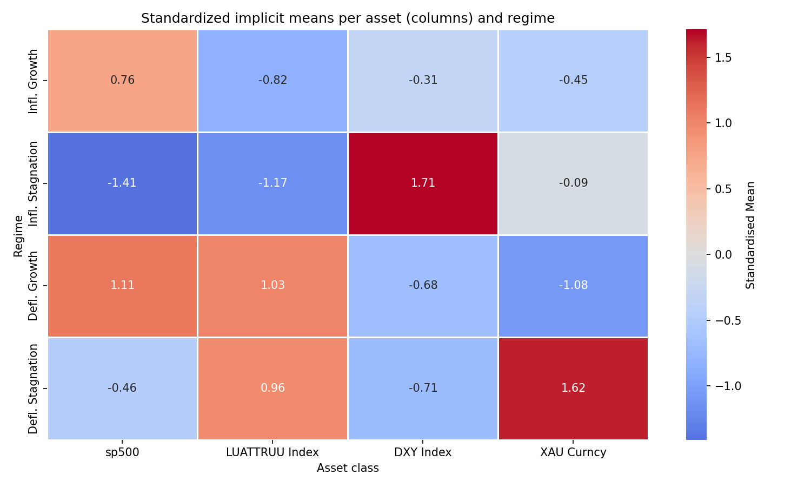
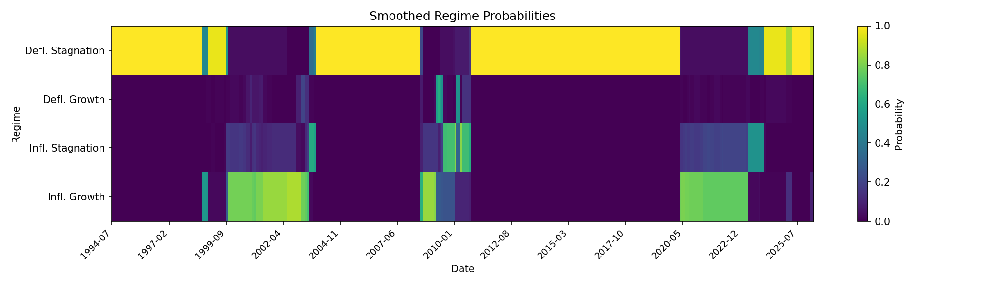
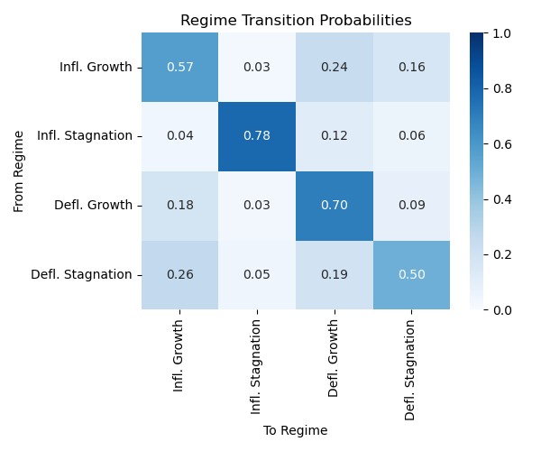
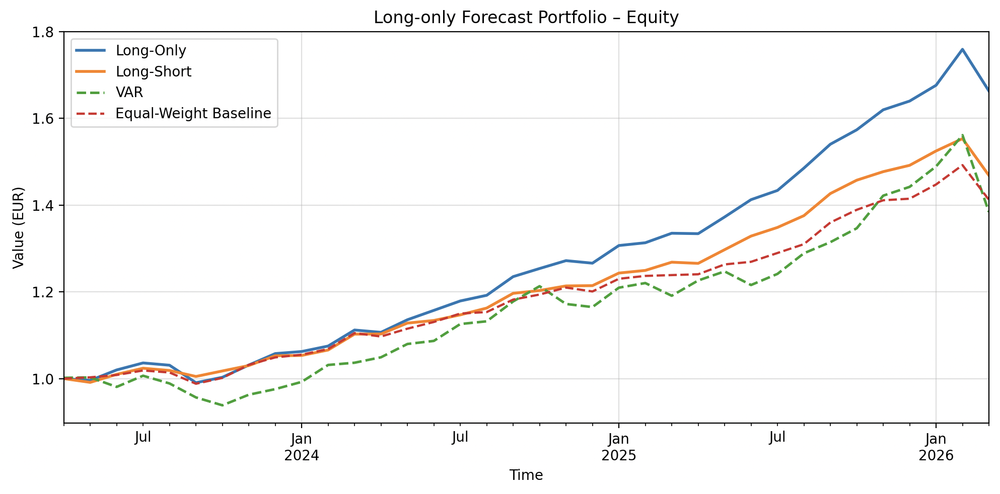

# Regime Detection and Forecasting in Multi-Asset Markets

**A Markov-Switching Heteroskedastic Bayesian Structural VAR (MSH-BSVAR) in Python**

This repository contains the full implementation behind my Master's thesis in Data Science and Business Analytics at Bocconi University (June 2026).

📄 **Full thesis:** [thesis/Master_Thesis.pdf](thesis/Master_Thesis.pdf)

---

## Research question

> *Can a Markov-Switching Heteroskedastic Bayesian Structural VAR framework identify regime-dependent dynamics across financial asset classes and produce economically meaningful forecasts for portfolio allocation?*

Financial markets do not follow one stable data-generating process. Volatility, correlations and return dynamics change between calm expansions, inflation shocks and crises. Standard VARs assume constant parameters and cannot capture these shifts. This project combines three ideas in one Bayesian model:

- **Markov switching:** a latent first-order Markov chain moves the market between regimes.
- **Structural identification:** regime-specific impact matrices make shocks economically interpretable.
- **Bayesian estimation:** shrinkage priors and MCMC carry parameter and regime uncertainty through to every result.

The entire estimation pipeline is written from scratch in Python. It covers the Gibbs sampler, Metropolis–Hastings steps, Hamilton filter, Kim smoother, regime relabelling, IRFs and FEVDs, model comparison, forecasting and portfolio backtesting.

## Key results

The model is estimated on monthly data from **February 1994 to April 2026** for four asset classes: **S&P 500, U.S. bonds, the U.S. Dollar Index (DXY) and gold**. The baseline specification uses `M = 4` regimes and `p = 4` lags, with 5,000 MCMC draws of which 2,000 are burn-in.

### Four economically interpretable regimes

The regimes are labelled by the sign combination of conditional equity and bond returns:

| Regime | Equities | Bonds | Characteristics |
|---|---|---|---|
| **Inflationary growth** | ↑ | ↓ | Low volatility, strongest cross-asset transmission |
| **Inflationary stagnation** | ↓↓ | ↓ | Strong USD, most persistent regime (p = 0.78) |
| **Deflationary growth** | ↑↑ | ↑ | Best regime for diversified portfolios, highest equity/bond volatility |
| **Deflationary stagnation** | ↓ | ↑ | Flight to safety: gold strongest, high gold volatility |

<p align="center">
  
</p>

### Historical regime path

The smoothed regime probabilities line up with major market episodes:
- the dot-com cycle (inflationary growth and stagnation)
- the global financial crisis and the post-2008 low-rate decade (deflationary stagnation)
- the COVID-19 shock and the following reopening and inflation phase

At the end of the sample (April 2026), the model assigns **inflationary stagnation** a probability of about **68.7 %**.

<p align="center">
  
</p>

### Regime persistence

The transition matrix has a clear diagonal, so regimes tend to last rather than switch at random from month to month. Markets rarely jump straight from stagflation into a broad expansion (p = 0.04). Instead, they tend to pass through deflationary growth first.

<p align="center">
  
</p>

### Structural transmission

- **Structural matrices:** in inflationary growth, equity shocks spill strongly into bonds (≈ 0.77) and the dollar (≈ 0.94). In inflationary stagnation these links almost disappear (equities → bonds ≈ 0.04).
- **Impulse responses:** most shocks die out within 5–10 months, but their size and propagation path depend on the regime.
- **FEVD** (S&P 500, horizon 20): the main source of equity uncertainty changes with the regime. Gold shocks dominate in inflationary growth (36 %), equity shocks in inflationary stagnation (45 %), and bond shocks in deflationary growth (47 %).
- **Model comparison:** the baseline model reaches a log marginal data density of 308.83. Savage–Dickey density ratios (log scale 1.65–3.87) show that the regimes differ meaningfully from one another.

### Out-of-sample forecasting (last 36 months)

Forecasts are produced recursively, using only the data available at each date.

| Asset | Accuracy | Precision | Recall | F1 |
|---|---|---|---|---|
| S&P 500 | 69.4 % | 84.2 % | 66.7 % | 0.742 |
| Bonds | 63.9 % | 62.1 % | 90.0 % | 0.735 |
| DXY | 69.4 % | 64.3 % | 60.0 % | 0.621 |
| Gold | **75.0 %** | 84.6 % | 81.5 % | **0.830** |

### Portfolio backtest

Sign forecasts are turned into monthly equal-weight signals. A signal published at month-end *t* is traded in month *t + 1* to avoid look-ahead bias. Results include transaction costs and a cash yield.

| Strategy | CAGR | Ann. volatility | Max drawdown | Total gain |
|---|---|---|---|---|
| **Long-only forecast** | **22.1 %** | 7.0 % | −5.5 % | **66.3 %** |
| Long-short forecast | 15.6 % | 5.6 % | −5.5 % | 46.9 % |
| VAR benchmark | 12.7 % | 11.0 % | −11.4 % | 38.2 % |

The long-only strategy also ranks in the upper tail of **1,000 random buy-and-hold portfolios** with Dirichlet-drawn weights.

<p align="center">
  
</p>

> The out-of-sample window is short. These results show that the regime information is useful, not that markets are persistently predictable. See Section 5.8 of the thesis for robustness and limitations.

---

## Methodology

### Model

For regime $s$, the structural VAR of order $p$ is

$$A_s Y_t = c_s + \sum_{i=1}^{p} B_{i,s} Y_{t-i} + \varepsilon_{t,s}, \qquad \varepsilon_{t,s} \sim \mathcal{N}(0, \Sigma_s), \quad \Sigma_s = \text{diag}(\sigma^2_{1,s}, \dots, \sigma^2_{K,s})$$

The regime $S_t \in \{1,\dots,M\}$ follows a first-order Markov chain with transition matrix $P = (p_{ij})$. The model is estimated in its reduced form, $\Omega_s = A_s^{-1}\Sigma_s (A_s^{-1})^\top$. Identification is recursive: each $A_s$ is lower triangular with a unit diagonal, and the variable ordering is equities → bonds → USD → gold.

### Priors (symmetric across regimes)

| Parameter | Prior |
|---|---|
| VAR coefficients | Normal–Inverse-Wishart with Minnesota/Litterman shrinkage (hyperparameters chosen by grid search) |
| Free structural parameters in $A_s$ | Diffuse multivariate normal centred at 0 |
| Structural shock variances | Inverse gamma |
| Rows of the transition matrix | Dirichlet, tilted towards persistent regimes |

### Estimation: block Gibbs sampler

1. **Initialisation:** OLS VAR, then an EM pre-classification based on volatility, then regime-specific starting values.
2. Draw the **VAR coefficients** (Gaussian conditional posterior).
3. Draw the **shock variances** (inverse-gamma conditional posterior).
4. Draw the **regime path** with forward filtering / backward sampling (Hamilton filter + Kim smoother).
5. Draw the **transition matrix** (Dirichlet posterior).
6. Update the **structural parameters** with a **Metropolis–Hastings** step, because they have no closed-form posterior.
7. **Relabel regimes after sampling** by their economic meaning (equity/bond sign pattern) to resolve label switching.

### Post-estimation

- Regime-specific **impulse response functions** and **forecast error variance decompositions**, computed for every draw
- **Marginal data density** via importance sampling (model comparison)
- **Savage–Dickey density ratio** (Bayesian hypothesis tests)
- MCMC diagnostics: trace plots and posterior densities
- **Binary out-of-sample evaluation** and **long-only / long-short backtests** against an equal-weight portfolio, a rolling VAR strategy and random buy-and-hold portfolios

---

## Repository structure

```
├── run_binary.py                  # Main pipeline: grid search → OOS evaluation → full-sample
│                                  #   estimation → IRF/FEVD/MDD/SDDR → backtests (M = 4)
├── run_binary_8regimes.py         # Same pipeline with M = 8 regimes
├── models/
│   ├── msh_bsvar_sampler.py       # Gibbs sampler (calls all sub-steps)
│   ├── initialisation.py          # OLS / EM-based initial state
│   ├── em_msh.py                  # Starting values for regimes, variances, transitions
│   ├── priors.py                  # Litterman / NIW priors
│   ├── restrictions.py            # Recursive (lower-triangular) identification
│   ├── regression.py              # Regime-specific VAR coefficient draws
│   ├── structrual_mh.py           # Metropolis–Hastings step for A_s
│   ├── update_hyper.py            # Inverse-gamma / hyperparameter updates
│   ├── hidden_markov.py           # Transition matrix draws
│   ├── filtering_smoothing.py     # Hamilton filter & Kim smoother
│   ├── general_functions.py       # Densities and numerical helpers
│   ├── mdd_estimation.py          # Marginal data density
│   ├── sddr.py                    # Savage–Dickey density ratio
│   ├── permutation.py, permutation2.py  # Economic regime relabelling
│   ├── post_analysis.py           # FEVD, structural matrices, forecasts, regime statistics
│   ├── plot_irf.py, plot_regimes.py, plot_mcmc.py
│   ├── test_binary.py             # Train/test split, OOS forecasting, sign evaluation
│   ├── grid_search_binary.py      # Grid search over p and M
│   ├── long_only_forecast_backtest.py   # Signal construction & portfolio backtests
│   └── benchmark_strategies.py    # Rolling-VAR benchmark
├── *.ipynb                        # Data download, cleaning, merging, HP filter, ADF tests, EDA
├── docs/images/                   # Figures used in this README
└── thesis/Master_Thesis.pdf       # Full Master's thesis
```

## Getting started

```bash
git clone https://github.com/LMichael27/msh-bsvar-market-regimes.git
cd msh-bsvar-market-regimes
pip install -r requirements.txt
python run_binary.py
```

Figures are written to `Figures/` (`grid/`, `eval/`, `plots/`).

### Key parameters

These are set at the top of `run_binary.py`:

| Parameter | Meaning | Thesis value |
|---|---|---|
| `p` | VAR lag order | 4 |
| `M` | Number of regimes | 4 |
| `S` | Retained Gibbs draws | 3,000 |
| `burnin` | Burn-in iterations | 2,000 |

The script's defaults (`S = 10`, `burnin = 5`) are only for a quick test run. Use the thesis values to reproduce the results. The grid search can replace `p` and `M` with the best-performing combination.

## Data

**The data is not included in this repository.** Data up to July 2025 comes from Bloomberg, which may not be redistributed. Later observations were extended with Yahoo Finance data.

The pipeline expects `data/updated.csv` with a `DATE` column and month-end price levels:

| Column | Asset |
|---|---|
| `sp500` | S&P 500 Index |
| `LUATTRUU Index` | Bloomberg U.S. bond index |
| `DXY Index` | U.S. Dollar Index |
| `XAU Curncy` | Gold spot price |

Prices are converted to log returns, $r_{i,t} = \log(P_{i,t}/P_{i,t-1})$. To use your own data, change the file path and the `ordering` list at the top of the run script. [`yfinance_data_download.ipynb`](yfinance_data_download.ipynb) shows how to get comparable series from public sources.

## Limitations & future work

- The model is highly parameterised relative to the sample size, so individual estimates depend on priors and initialisation.
- The regime labels interpret return patterns. No macroeconomic variables enter the model.
- The out-of-sample window is short (36 months).
- Possible extensions: macro variables, time-varying transition probabilities, other numbers of regimes, and mean-variance or volatility-targeting portfolios.

## Key references

- Hamilton (1989): *A New Approach to the Economic Analysis of Nonstationary Time Series and the Business Cycle*
- Kim & Nelson (1999): *State-Space Models with Regime Switching*
- Sims & Zha (1996): *Bayesian Methods for Dynamic Multivariate Models*
- Lanne, Lütkepohl & Maciejowska (2010): *Structural Vector Autoregressions with Markov Switching*
- Lütkepohl & Woźniak (2018): *Bayesian Inference for Structural VARs Identified by Markov-Switching Heteroskedasticity*
- Kilian & Lütkepohl (2017): *Structural Vector Autoregressive Analysis*

The full bibliography is in the thesis.

## Author

**Michael Ladaa**, MSc Data Science and Business Analytics, Bocconi University
